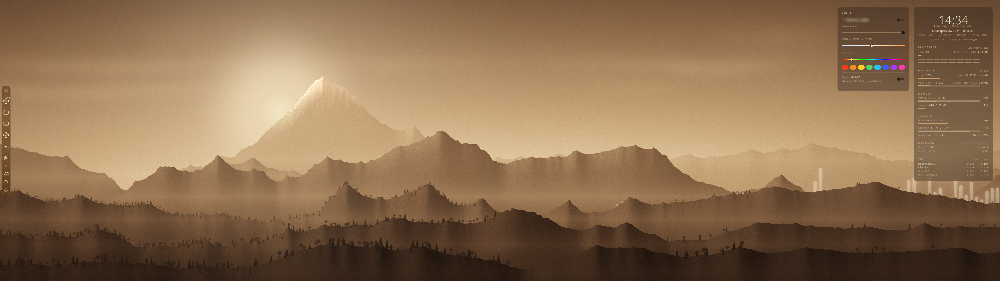
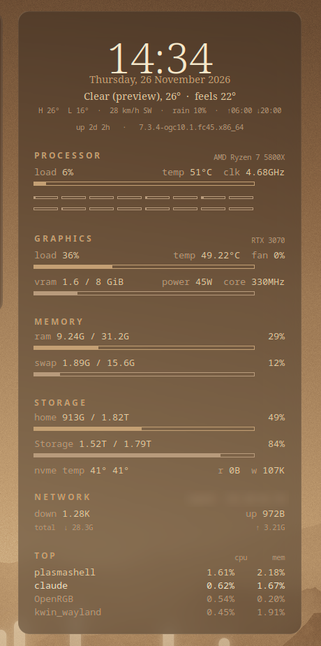
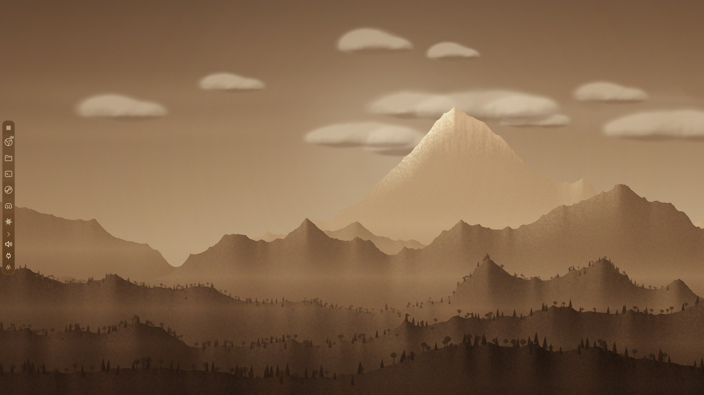
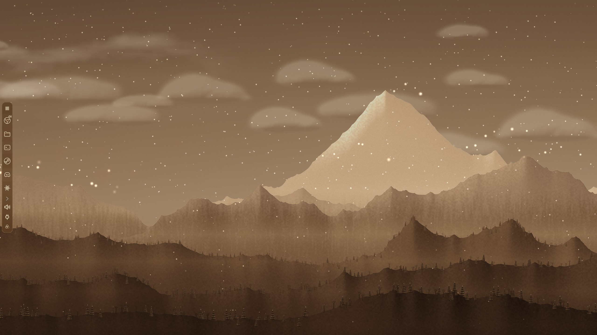
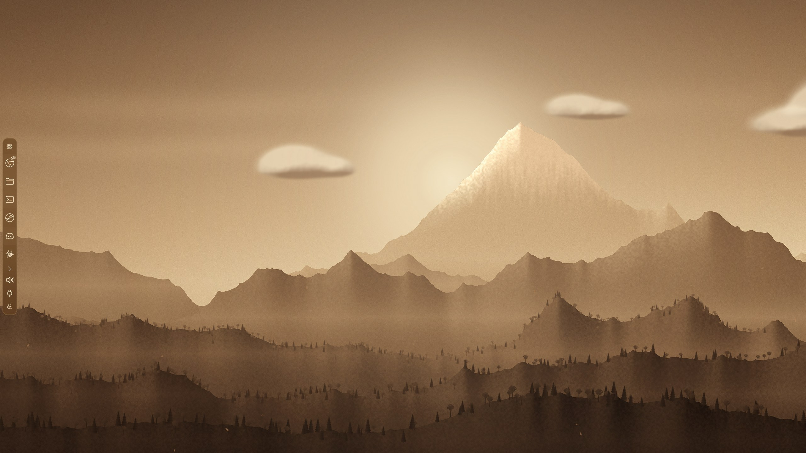
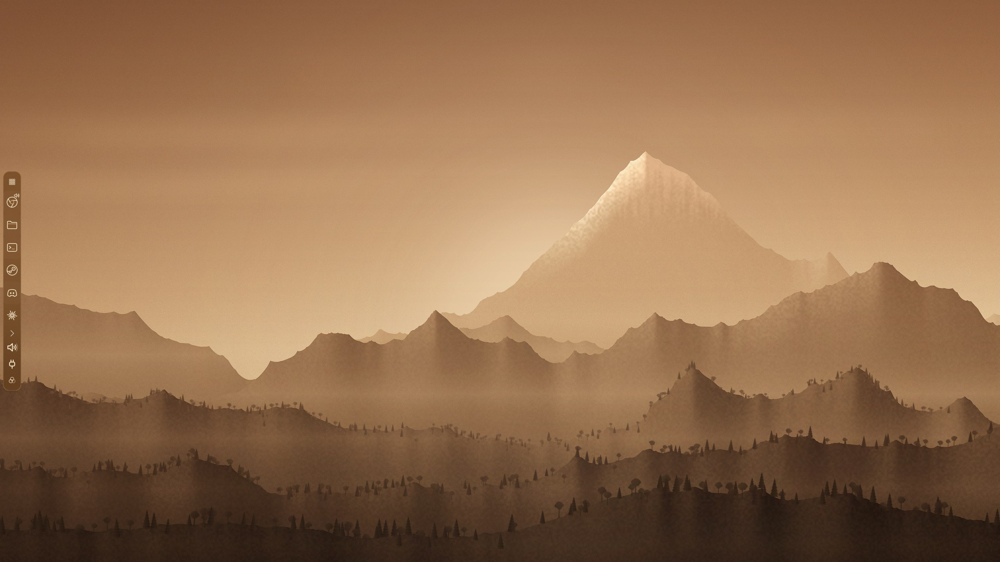
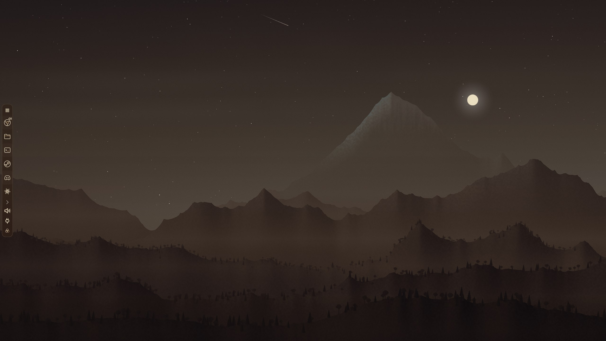
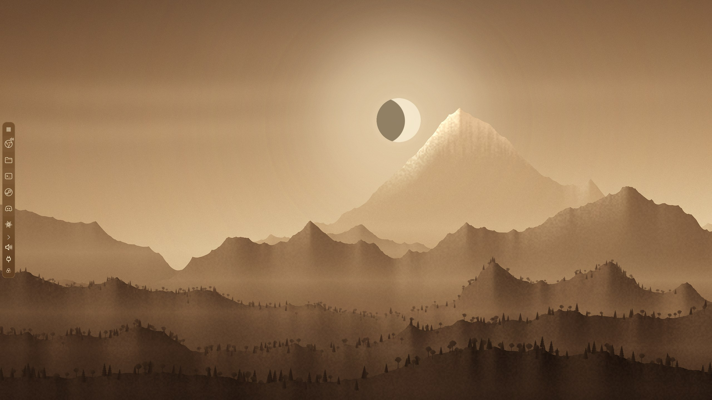
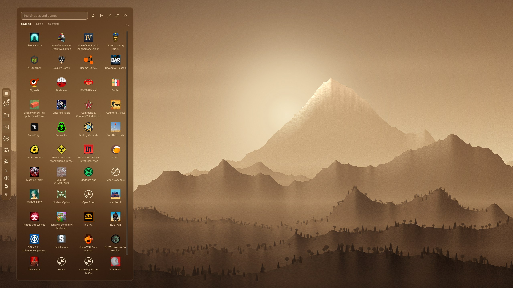

# Sepia Summit

**A Rainmeter-style sepia desktop for Linux: KDE Plasma 6, Bazzite and Fedora Atomic.**

[](docs/screenshots/desktop.jpg)

<sub>A real capture of both monitors at full resolution (5120×1440); click it to see it full size. The light widget beside the panel is the owner's own and isn't part of the kit.</sub>

<p align="center"></p>

What's included:

- **Wallpaper**: a sepia mountain range generated for this kit. It comes in sizes for dual 1440p, dual 1080p, ultrawide (3440 and 2560) and single screens. All sizes show the same mountains, so the scene carries across both monitors. The tall peaks sit on the left, with calmer sky on the right where the widgets go.
- **Conky stats panel** (right edge): clock, today's weather, CPU load/temp/clock speed with 16 per-thread bars, RTX 3070 load/temp/VRAM/power/fan, RAM/swap, drive space, NVMe temps, disk read/write, network and top processes.
- **Live wallpaper with the visualiser behind the mountains**: a Plasma 6 wallpaper plugin draws the wallpaper, then full-width audio bars (on the right monitor with two screens), then a cut-out of the nearer ridges on top. The bars look like they're rising out of the valley behind the mountains. When nothing is playing it's just the normal wallpaper.
- **Live weather and day/night**: clouds drift behind the peaks on cloudy days, the sky greys over when it's overcast, and faint rain, snow or valley fog appear when the real weather does. The sun crosses the sky where it really is at your town, sets behind the ridges, and the scene glows at sunrise and sunset and goes dark and starry at night, so daylight saving and the seasons take care of themselves.
- **Eclipses and meteor showers**: worked out for your town. When a solar eclipse is visible there, the moon bites into the sun and, at totality, the sky goes dark around a soft corona. In a lunar eclipse the Earth's shadow creeps over the moon and turns it a dim rust. During the Perseids, Geminids and other showers, meteors streak away from the shower's radiant at roughly the rate you'd see outside. `sepia-weather events` lists what's coming.
- **Seasons**: the snowline creeps down the peaks through winter (and after real snowfall), trees on the foothills fill out in summer, thin and lighten in autumn, go bare in winter and blossom in spring. Fireflies drift over the hills on warm summer nights, leaves blow past on windy autumn days, snow streams off the peaks in a gale, mist drifts through the valleys, and the moon rises with its real phase.
- **Glass dock and app drawer** (left edge of the left monitor): a frosted-glass dock with cream line icons for your browser (Chrome, Brave or Firefox, whichever is your default), files, terminal, Steam, Discord and Claude, plus your open apps. The drawer sorts everything into Games, Apps and System, with search and lock, log out, sleep, restart and shut down buttons. The conky panel sits on frosted glass too.
- **Matching theme**: a sepia Plasma style, app colours and Konsole profile.

Conky and the live wallpaper draw natively, so they use far less than Rainmeter did. Expect well under 1% CPU.

```
install.sh                 one-shot installer (safe to re-run)
conky/sepia.conf           the stats panel
conky/scripts/temps.sh     CPU + NVMe temps (finds sensors by name)
conky/scripts/gpu.sh       NVIDIA stats (cached nvidia-smi)
cava/config                sepia colours for terminal CAVA
plasma/wallpaper/          the live wallpaper plugin (com.nexuskiwi.sepiasummit)
plasma/sepia-cava-server.py  runs CAVA and serves audio levels on 127.0.0.1:37421
plasma/sepia-cava.service  user service that keeps the server running
plasma/sepia-weather.py    fetches the weather (Open-Meteo, free, no account)
plasma/sepia-weather.timer refreshes it every 10 minutes
plasma/set-wallpaper.js    picks the right images for each monitor
plasma/apply-dock.js       sets up the glass dock
plasma/icons/sepia-summit/ cream line icons (generated by tools/make_icons.py)
plasma/drawer/             the app drawer widget
plasma/theme/, plasma/colors/, konsole/   Plasma style (generated by tools/make_plasma_style.py), app colours, Konsole profile
plasma/trayitem/           dock button for an app that lives in the tray (OpenRGB)
wallpapers/                all the PNGs: dual images come pre-split _LEFT/_RIGHT,
                           and every image has a _front.png ridge cut-out and
                           a _sky.png mask (where clouds and stars may go) and
                           a _snow.png map (where snow settles first)
tools/make_wallpaper.py    the generator, if you want different mountains
                           (it also writes the tree positions, contents/code/scene.js)
tools/make_weather_assets.py  draws the clouds, rain, snow, tree and leaf sprites
```

---

## Gallery

Real captures of the left monitor at full 1440p, made with `sepia-weather preview` (see [Weather and day/night](#4-weather-and-daynight)). Click any picture for the full-size version.

<table>
<tr><td width="50%"><a href="docs/screenshots/cloudy.jpg"></a><br><sub>Cloud drifting behind the peaks</sub></td><td width="50%"><a href="docs/screenshots/rain.jpg"></a><br><sub>A rain shower, kept faint</sub></td></tr>
<tr><td width="50%"><a href="docs/screenshots/snow.jpg"></a><br><sub>Winter: snow falling, snowline low on the peaks</sub></td><td width="50%"><a href="docs/screenshots/fog.jpg"></a><br><sub>Valley fog</sub></td></tr>
<tr><td width="50%"><a href="docs/screenshots/autumn.jpg"></a><br><sub>Autumn: thinner, lighter trees</sub></td><td width="50%"><a href="docs/screenshots/dusk.jpg"></a><br><sub>Sunset glow</sub></td></tr>
<tr><td width="50%"><a href="docs/screenshots/night.jpg"></a><br><sub>Night, with the moon in its real phase</sub></td><td width="50%"><a href="docs/screenshots/meteor.jpg"></a><br><sub>A meteor during a shower</sub></td></tr>
<tr><td width="50%"><a href="docs/screenshots/eclipse-partial.jpg"></a><br><sub>Solar eclipse: the moon bites into the sun</sub></td><td width="50%"><a href="docs/screenshots/eclipse-total.jpg"></a><br><sub>Totality: dark sky, corona, stars</sub></td></tr>
<tr><td width="50%"><a href="docs/screenshots/drawer.jpg"></a><br><sub>The glass dock with the app drawer open</sub></td><td></td></tr>
</table>

## 1. Install

```bash
git clone https://github.com/NexusKiwi/sepia-summit.git
cd sepia-summit
```

Then:

```bash
./install.sh
```

If `cava` is missing, the first run offers to layer it with `rpm-ostree`. Say **y**, **reboot**, then run `./install.sh` again. The installer restarts Plasma a few times, so save your work first. It:

- detects your network adapter, main drive, any extra drives mounted under `/run/media` or `/var/mnt` (game drives etc.), and how many monitors you have
- installs the conky panel and adds it to autostart
- asks for your nearest town once, for the weather and the day/night sky (a town is enough; only its coordinates are sent to Open-Meteo)
- installs the live wallpaper plugin and starts the audio service (`sepia-cava.service`)
- copies the wallpapers to `~/Pictures/Wallpapers/sepia-mountains` and sets them **per monitor**. With two screens, the left screen gets the left half and the right screen gets the right half. With an ultrawide, it gets the ultrawide image.
- replaces your taskbars with the glass dock and app drawer, pins your browser, files, terminal and (if installed) Steam, Discord and Claude, and hides desktop icons from view (the files stay in `~/Desktop`)
- sets the lock screen to the sepia mountains, matching the desktop across both monitors when there are two (your previous lock screen settings are backed up)
- applies the sepia Plasma style (frosted glass where KWin can blur, with a little more blur than KWin's default), app colours and Konsole profile
- switches to the Sepia Summit icons, which replace only those few app icons and keep everything else from the icon theme you had

Your previous settings are saved in `~/.local/share/sepia-summit/backups/`.

If it guesses something wrong, you can override it:
```bash
HEAD=0 ./install.sh            # put conky on the other monitor
IFACE=enp5s0 DISK=nvme1n1 ./install.sh
LIVE=0 ./install.sh            # plain static wallpaper, no visualiser
DOCK=0 ./install.sh            # keep your own panels and desktop icons
THEME=0 ./install.sh           # keep your Plasma style, colours and Konsole profile
GLASS=0 ./install.sh           # leave KWin's blur settings alone
ICONS=0 ./install.sh           # keep your icon theme
LOCK=0 ./install.sh            # keep your own lock screen picture
PLACE="Lisbon" ./install.sh    # set or change the weather town without being asked
```

## 2. The dock and app drawer

The dock floats down the left edge of the left monitor and holds the drawer button, your pinned and open apps, the tray arrow, and cream volume and network buttons. Apps that sit in the tray, like OpenRGB, get their own dock button below them if they're running when you install (click to open, right-click for their menu). Drag an app off it to unpin it, or right-click a running app → *Pin to Task Manager* to add one. It stays out of the way of your windows: it shows on a clear desktop and slips away when a window covers it, so maximised windows fill the whole screen. Push the mouse to the left edge beside the dock and it floats back over them. The grid button or the Meta key opens the drawer. Type to search, and press Enter to launch the first result. The buttons beside the search bar lock, log out, sleep, restart and shut down. Hibernate also appears if your system supports it. Log out, restart and shut down always ask first.

## 3. The visualiser behind the mountains


<sub>Mock-up of the bars at full height; the hero picture at the top shows them for real.</sub>

This works once the installer has run. Play anything — Spotify, YouTube, a game — and bars rise from behind the middle ridge. With two monitors they appear on the right one only.

How it works: `sepia-cava.service` runs CAVA and serves the audio levels on `127.0.0.1` only. The wallpaper plugin reads them about 30 times a second and draws the bars between the wallpaper and the ridge cut-out.

To adjust it, right-click the desktop → **Desktop and Wallpaper**. With **Sepia Summit (live)** selected, you can change:

| setting | default | what it does |
|---|---|---|
| Bars per screen | 96 | more = thinner bars |
| Valley line | 80% | where the bars start, measured from the top. Keep it below the ridge so the bases stay hidden |
| Max bar height | 42% | how far up the sky they can reach |
| Opacity | 50% | lower = hazier, more like light than bars |
| Bar colour | `#f5e6c8` | try `#e4cca2` for warmer bars |
| Glow | on | soft bloom around the bars |

**Bars behind a different ridge:** regenerate with `--split`. 0 is the farthest range and 5 the nearest; the default is 3. Higher numbers put more mountains in front of the bars:
```bash
python3 tools/make_wallpaper.py wallpapers --split 2
```

You can still add the **Kurve** widget for a small visualiser somewhere else. Find it under Add Widgets → Get New Widgets and search "Kurve".

## 4. Weather and day/night

`sepia-weather` fetches the current weather every 10 minutes (`sepia-weather.timer`). Conky shows it under the date, and the live wallpaper turns it into the sky: clouds for cloud cover, a grey deck when it's overcast, faint rain, snow, valley fog, and a soft glow for thunderstorms. The sun and moon are drawn where they really are at your town: you look out towards the equator, so south of it the sun rises on the right and sets on the left behind the big peak, and north of it the other way round. It also works out the eclipses visible from your town and any meteor shower that's on (locally, nothing extra is downloaded).

```bash
sepia-weather setup "Your town"     # change the location
sepia-weather preview rain night    # try a look: clear partly cloudy overcast fog drizzle
                                    #   rain showers snow storm, at day / dusk / night
sepia-weather preview clear night summer temp=19      # fireflies
sepia-weather preview overcast day winter wind=45 snow=6   # deep snow blowing off the peaks
sepia-weather preview eclipse=solar             # a total eclipse, squeezed into 4 minutes
sepia-weather preview clear eclipse=lunar meteors=60   # blood moon during a meteor shower
sepia-weather events                # eclipses visible from your town in the next 3 years
sepia-weather fetch                 # back to the real weather
```

The seasons follow the date and your hemisphere: summer is December to February south of the equator and June to August north of it. Recent snowfall at your town pulls the snowline lower for a few days.

A preview lasts until the next timer run after 15 minutes, or until `sepia-weather fetch`.

Weather, day/night, seasons and the glass behind conky can each be switched off per screen in the wallpaper settings (Desktop → Configure → Sky).

## 5. Optional finishing touches

The installer already applies the Plasma style, app colours and Konsole profile. Two extras you can set by hand:

- **Window decorations**: Breeze with "No borders" gives a cleaner look for screenshots.
- **Font**: for a vintage feel, set the window title font to *Noto Serif*.

## 6. Customising

- **Different CPU?** The panel shows 16 per-thread bars (a Ryzen 7 5800X). For a different thread count, add or remove `${cpubar cpuN 3,34}` entries in the PROCESSOR section. The GPU section needs an NVIDIA card (it uses `nvidia-smi`).
- **Panel layout/colours**: edit `~/.config/conky/sepia/sepia.conf`. Conky reloads by itself when you save, but on Wayland the reloaded panel can open on the wrong monitor; log out and in (or re-run the autostart command) to put it back. The colours are `color1`–`color4` near the top. Panel opacity and corner radius are `ALPHA` and `RADIUS` at the top of `~/.config/conky/sepia/scripts/panel.lua`.
- **Different mountains**: change the seed. This needs numpy and pillow; on Bazzite, run it in a distrobox:
  ```bash
  python3 tools/make_wallpaper.py wallpapers --seed 7
  ```
  Then re-run `./install.sh`. Try a few seeds — each gives a different range. The sepia palette is at the top of the script. The images leave the sun out because the live wallpaper draws it; add `--painted-sun` for a static wallpaper with the low sun painted in.

## Troubleshooting

**Conky doesn't show up.** Run `~/.local/bin/sepia-conky -c ~/.config/conky/sepia/sepia.conf` in a terminal to see its errors. The panel needs conky 1.25 or newer on Wayland. `install.sh` downloads a verified copy to `~/.local/bin/sepia-conky` if your system version is older.

**It's on the wrong monitor.** Run `HEAD=0 ./install.sh` for the leftmost monitor, `HEAD=1` for the next one, and so on.

**Temps show `--`.** Run `~/.config/conky/sepia/scripts/temps.sh cpu`. AMD CPU temps come from the `k10temp` sensor, which loads by default on Bazzite.

**The wallpaper went black after install.** Plasma hasn't picked up the new plugin yet. Run `systemctl --user restart plasma-plasmashell`. If you'd rather not use it, run `LIVE=0 ./install.sh` to go back to the plain image.

**The bars don't move.** Check the audio service:
```bash
systemctl --user status sepia-cava
curl -s http://127.0.0.1:37421/ | head -c 80; echo   # should print numbers while music plays
```
If `cava` isn't found, layer it (`rpm-ostree install cava`) and reboot.

**No weather / "weather unavailable".** Check `sepia-weather fetch` prints no error and `systemctl --user list-timers sepia-weather.timer` shows a next run. The wallpaper reads `~/.cache/sepia-summit/weather.qml`, which should exist and be recent.

**GPU shows `no nvidia-smi`.** You need the `bazzite-nvidia` image. It ships `nvidia-smi`.

## Inspiration

The old /g/ desktop threads live on as **r/unixporn**: search "sepia", "conky" or "kde". If you ever try a tiling setup like Hyprland, look at **Eww** and **Quickshell**. They're the next step past conky: fully scriptable bars and widgets, the closest thing to "Rainmeter, but with no limits".

## License

MIT. The wallpapers are generated by `tools/make_wallpaper.py` and are free to use, share and remix.
