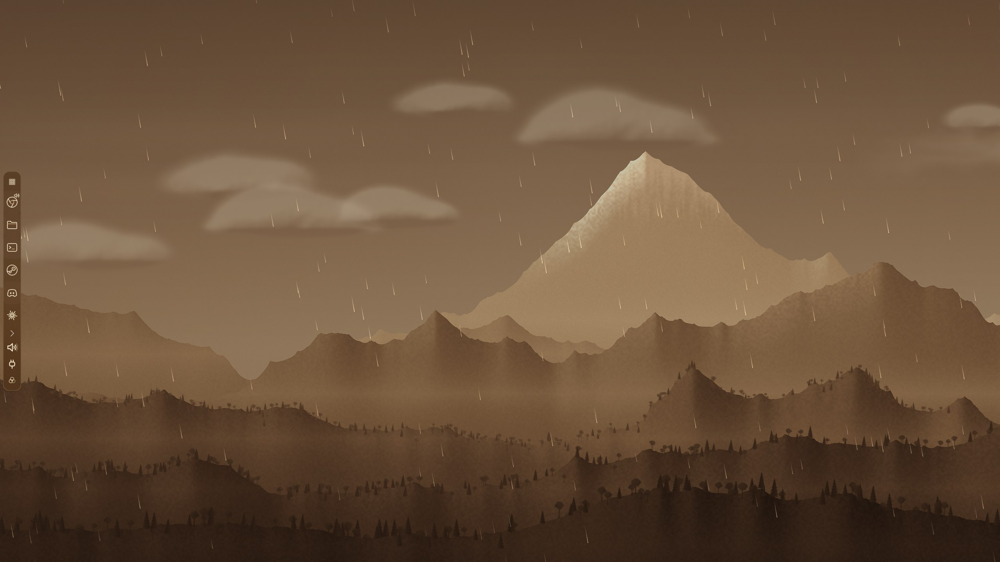
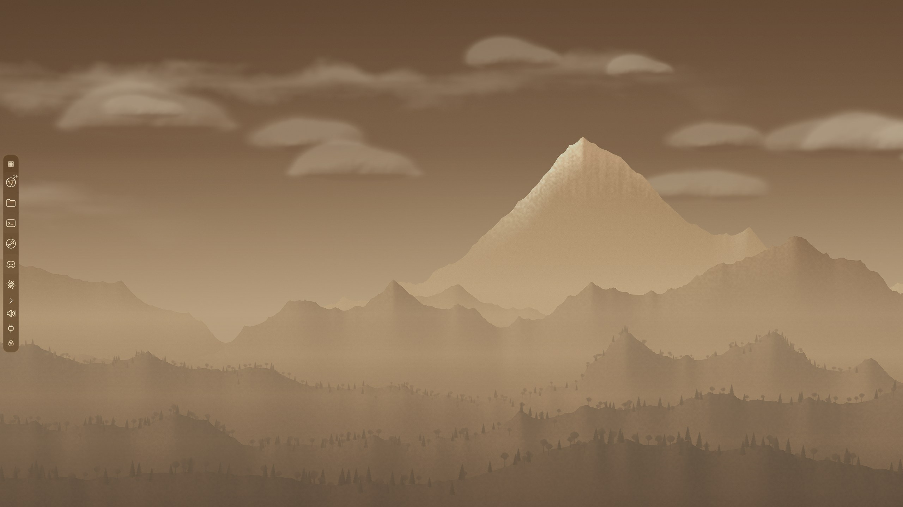
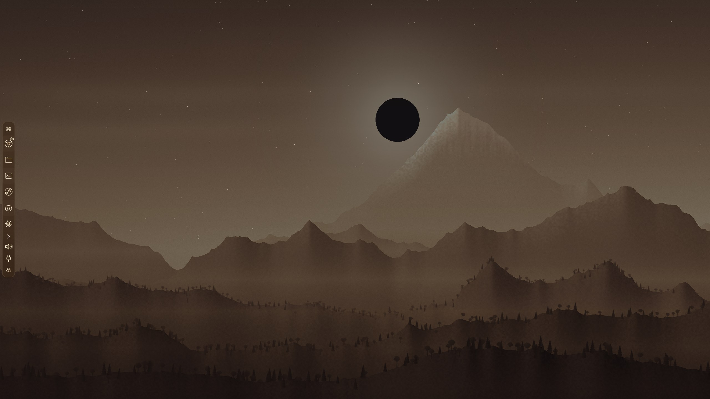
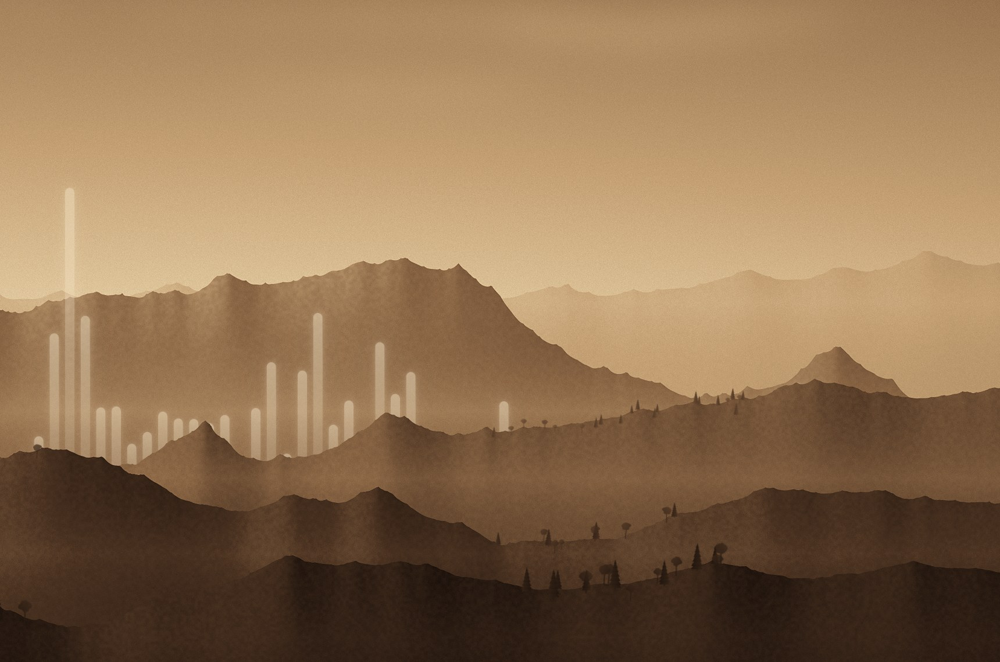

# Sepia Summit

**A Rainmeter-style sepia desktop for KDE Plasma 6 on Linux.**

A live mountain wallpaper with real weather, a sun and moon in their real positions, seasons, eclipses, and an audio visualiser that rises from behind the ridges. It comes with a conky stats panel, a frosted-glass dock and app drawer, and a matching Plasma theme. One script installs it all.

[](docs/screenshots/desktop.jpg)

<p align="center"><sub>A real capture of two 1440p monitors (click for full size). The light-control widget beside the stats panel is the author's own and isn't part of the kit.</sub></p>

<p align="center">
  <a href="#features">Features</a> ·
  <a href="#gallery">Gallery</a> ·
  <a href="#requirements">Requirements</a> ·
  <a href="#install">Install</a> ·
  <a href="#using-it">Using it</a> ·
  <a href="#uninstall">Uninstall</a> ·
  <a href="#troubleshooting">Troubleshooting</a>
</p>

## Features

- **Live sepia wallpaper.** A generated mountain range, sized for dual 1440p, dual 1080p, ultrawide (3440 and 2560) and single screens. Every size shows the same mountains, so the scene carries across two monitors.
- **Real weather.** Clouds drift behind the peaks, and the sky greys over when it's overcast. Faint rain, snow, valley fog and storm glow follow the actual weather at your town. The data comes from [Open-Meteo](https://open-meteo.com) (free, no account).
- **Day and night.** The sun crosses the sky where it really is and sets behind the ridges. The scene glows at sunrise and sunset, then goes dark and starry, with the moon in its real phase.
- **Seasons.** The snowline creeps down the peaks in winter. The trees fill out in summer, turn in autumn, go bare and then blossom. Fireflies come out on warm nights, leaves blow past on windy autumn days, and snow streams off the peaks in a gale.
- **Eclipses and meteor showers.** These are worked out for your town, so the sky darkens at totality and meteors streak away from the shower's radiant.
- **A visualiser behind the mountains.** Audio bars rise from the valley behind the nearer ridges while anything plays. When nothing is playing it's just the wallpaper.
- **A conky stats panel** on frosted glass. It shows a clock, the weather, CPU, NVIDIA GPU, RAM, drives, temperatures, network and top processes.
- **A glass dock and app drawer.** The dock has cream line icons and tray buttons. The drawer sorts apps into Games, Apps and System, with search and power buttons.
- **A matching theme**: Plasma style, colours, icons, Konsole profile and lock screen.

It all draws natively, so expect well under 1% CPU.

## Gallery

These are real captures at full 1440p, made with `sepia-weather preview` (see [Weather, day and night](#weather-day-and-night)). Click any picture for the full-size version.

<table>
<tr><td width="50%"><a href="docs/screenshots/cloudy.jpg"></a><br><sub>Cloud drifting behind the peaks</sub></td><td width="50%"><a href="docs/screenshots/rain.jpg"></a><br><sub>A rain shower, kept faint</sub></td></tr>
<tr><td width="50%"><a href="docs/screenshots/snow.jpg"></a><br><sub>Winter: falling snow, and the snowline low on the peaks</sub></td><td width="50%"><a href="docs/screenshots/fog.jpg"></a><br><sub>Valley fog</sub></td></tr>
<tr><td width="50%"><a href="docs/screenshots/autumn.jpg"></a><br><sub>Autumn: thinner, lighter trees</sub></td><td width="50%"><a href="docs/screenshots/dusk.jpg"></a><br><sub>Sunset glow</sub></td></tr>
<tr><td width="50%"><a href="docs/screenshots/night.jpg"></a><br><sub>Night, with the moon in its real phase</sub></td><td width="50%"><a href="docs/screenshots/meteor.jpg"></a><br><sub>A meteor during a shower (top left)</sub></td></tr>
<tr><td width="50%"><a href="docs/screenshots/eclipse-partial.jpg"></a><br><sub>Solar eclipse: the moon bites into the sun</sub></td><td width="50%"><a href="docs/screenshots/eclipse-total.jpg"></a><br><sub>Totality: dark sky, corona and stars</sub></td></tr>
<tr><td width="50%"><a href="docs/screenshots/visualiser.jpg"></a><br><sub>The visualiser rising from behind the ridges</sub></td><td width="50%"><a href="docs/screenshots/drawer.jpg"></a><br><sub>The glass dock with the app drawer open</sub></td></tr>
</table>

<p align="center"></p>

## Requirements

- **KDE Plasma 6.** It's developed and tested on Plasma 6.8 under Wayland, and should work on any recent Plasma 6. X11 sessions are less tested.
- **Python 3**, **curl** and **cava** (cava is optional, and only needed for the visualiser).
- **conky 1.25 or newer.** If your distro's conky is missing or older, the installer downloads the official conky AppImage and checks it against a pinned checksum. AppImages need **FUSE 2**, which is in the package lists below.
- **Monitors:** made for two 1440p screens side by side. Dual 1080p, ultrawide and single screens are supported too.
- **Optional:** an NVIDIA GPU for the GPU section of the stats panel (it reads `nvidia-smi`). On other GPUs that section shows `no nvidia-smi`.

## Install

### 1. Install the packages

Pick your distro:

<details open>
<summary><b>Fedora KDE Plasma</b></summary>

```bash
sudo dnf install cava curl python3 fuse-libs
```
</details>

<details>
<summary><b>Fedora Atomic: Bazzite, Kinoite, Aurora</b></summary>

```bash
rpm-ostree install cava
systemctl reboot
```
Python, curl and FUSE are already in the image. If you skip this step, the installer offers to layer cava for you.
</details>

<details>
<summary><b>Arch Linux, EndeavourOS, CachyOS, Manjaro</b></summary>

```bash
sudo pacman -S --needed cava curl python fuse2
```
</details>

<details>
<summary><b>Debian 13, Kubuntu 25.04+, KDE neon</b></summary>

```bash
sudo apt install cava curl python3 libfuse2t64
```
On older releases the FUSE package is called `libfuse2`. You need a release that ships Plasma 6.
</details>

<details>
<summary><b>openSUSE Tumbleweed</b></summary>

```bash
sudo zypper install cava curl python3 libfuse2
```
</details>

<details>
<summary><b>Anything else</b></summary>

Install `cava`, `curl`, `python3` and FUSE 2 (often `libfuse2` or `fuse2`) with your package manager. Everything else is in the repo, and the installer only needs the standard Plasma tools.
</details>

If cava is still missing when you run the installer, it offers to install it with `dnf`, `pacman`, `zypper` or `apt`, or to layer it with `rpm-ostree` on Atomic systems.

### 2. Run the installer

```bash
git clone https://github.com/NexusKiwi/Sepia-Summit.git
cd Sepia-Summit
./install.sh
```

Save your work first, because the installer restarts Plasma a few times. It asks once for your nearest town, for the weather and the sky. A town name is enough, and only its coordinates are sent to Open-Meteo.

What it does:

- detects your network adapter, main drive, any extra drives under `/run/media` or `/var/mnt`, and how many monitors you have
- installs the conky panel and adds it to autostart
- installs the live wallpaper and sets it **per monitor**: with two screens, each gets its half of the scene
- starts two small user services: `sepia-cava` for the audio levels (served on `127.0.0.1` only) and `sepia-weather.timer` for the weather every 10 minutes
- replaces your panels with the glass dock and app drawer. It pins your browser, files, terminal and (if installed) Steam, Discord and Claude. Desktop icons are hidden, but the files stay in `~/Desktop`
- sets a matching lock screen, and applies the Plasma style, colours, icons (only a few app icons are replaced) and Konsole profile
- turns up KWin's blur a little for the frosted glass

Everything it replaces is backed up to `~/.local/share/sepia-summit/backups/` first. It's safe to run again: re-running updates the install without touching your backups.

### Options

If it guesses something wrong, or you only want some of the kit, set these before `./install.sh`:

```bash
HEAD=0 ./install.sh            # put conky on another monitor (0 = leftmost)
IFACE=enp5s0 DISK=nvme1n1 ./install.sh   # network adapter / drive for the panel
PLACE="Lisbon" ./install.sh    # set or change the weather town without being asked
LIVE=0 ./install.sh            # plain static wallpaper: no visualiser, weather or sky
DOCK=0 ./install.sh            # keep your own panels and desktop icons
THEME=0 ./install.sh           # keep your Plasma style, colours and Konsole profile
GLASS=0 ./install.sh           # leave KWin's blur settings alone
ICONS=0 ./install.sh           # keep your icon theme
LOCK=0 ./install.sh            # keep your own lock screen
```

### Updating

```bash
cd Sepia-Summit
git pull
./install.sh
```

## Using it

### The dock and app drawer

The dock floats down the left edge of the left monitor. It holds the drawer button, your pinned and open apps, the tray arrow, and volume and network buttons. Apps that live in the tray, like OpenRGB, get their own button below those if they're running when you install: click to open, right-click for their menu.

- **Pin or unpin:** drag an app off the dock, or right-click a running app → *Pin to Task Manager*.
- **Windows:** the dock shows on a clear desktop and slips away when a window covers it, so maximised windows fill the screen. Push the mouse to the left edge and it floats back.
- **Drawer:** the grid button or the Meta key opens it. Type to search, and press Enter to launch the first result. The buttons beside the search bar lock, log out, sleep, restart and shut down (and hibernate, if your system supports it). Log out, restart and shut down always ask first.

### The visualiser

Play anything, from Spotify to YouTube to a game, and bars rise from behind the middle ridge. With two monitors they appear on the right one.

<p align="center"><a href="docs/screenshots/visualiser.jpg"></a></p>

`sepia-cava.service` runs CAVA and serves the audio levels on `127.0.0.1` only. The wallpaper reads them about 30 times a second and draws the bars between the wallpaper and a cut-out of the nearer ridges.

To adjust it, right-click the desktop → **Desktop and Wallpaper**, with **Sepia Summit (live)** selected:

| setting | default | what it does |
|---|---|---|
| Bars per screen | 96 | more = thinner bars |
| Valley line | 80% | where the bars start, from the top. Keep it below the ridge so the bases stay hidden |
| Max bar height | 42% | how far up the sky they can reach |
| Opacity | 50% | lower = hazier, more like light than bars |
| Bar colour | `#f5e6c8` | try `#e4cca2` for warmer bars |
| Glow | on | soft bloom around the bars |

To put the bars behind a different ridge, regenerate with `--split`. 0 is the farthest range and 5 the nearest (the default is 3):
```bash
python3 tools/make_wallpaper.py wallpapers --split 2
```

### Weather, day and night

`sepia-weather` fetches the weather every 10 minutes. The stats panel shows it under the date, and the wallpaper turns it into the sky. The sun and moon are drawn where they really are at your town. You look out towards the equator, so south of it the sun sets on the left behind the big peak, and north of it on the right. Eclipses and meteor showers are worked out locally, so nothing extra is downloaded.

```bash
sepia-weather setup "Your town"     # change the location
sepia-weather preview rain night    # try a look: clear partly cloudy overcast fog drizzle
                                    #   rain showers snow storm, at day / dusk / night
sepia-weather preview clear night summer temp=19           # fireflies
sepia-weather preview overcast day winter wind=45 snow=6   # deep snow blowing off the peaks
sepia-weather preview eclipse=solar                        # a total eclipse, squeezed into 4 minutes
sepia-weather preview clear eclipse=lunar meteors=60       # blood moon during a meteor shower
sepia-weather events                # eclipses visible from your town in the next 3 years
sepia-weather fetch                 # back to the real weather
```

A preview lasts until `sepia-weather fetch`, or until the next timer run after 15 minutes. The seasons follow the date and your hemisphere, and recent snowfall pulls the snowline lower for a few days.

Weather, day/night, seasons and the glass behind conky can each be switched off per screen in the wallpaper settings (Desktop → Configure → Sky).

## Customising

- **Different CPU:** the panel shows 16 per-thread bars, made for an 8-core/16-thread CPU. For a different thread count, add or remove `${cpubar cpuN 3,34}` entries in the PROCESSOR section of `~/.config/conky/sepia/sepia.conf`.
- **Panel layout and colours:** edit `~/.config/conky/sepia/sepia.conf`. The colours are `color1`–`color4` near the top. Conky reloads by itself when you save, but on Wayland the reloaded panel can open on the wrong monitor; log out and back in to put it back. Panel opacity and corner radius are `ALPHA` and `RADIUS` at the top of `~/.config/conky/sepia/scripts/panel.lua`.
- **Different mountains:** change the seed, then re-run `./install.sh`. Each seed gives a different range. This needs numpy and pillow (on an Atomic system, run it in a distrobox):
  ```bash
  python3 tools/make_wallpaper.py wallpapers --seed 7
  ```
  The sepia palette is at the top of the script. Add `--painted-sun` for a static wallpaper with a low sun painted in.
- **Finishing touches:** Breeze window decorations with "No borders" give a cleaner look, and *Noto Serif* as the title-bar font adds a vintage feel.

## Uninstall

There's no uninstall script yet, so these steps undo the install by hand. First put your old settings back, then remove the files. The order matters: removing the wallpaper plugin first would leave the desktop black.

**1. Stop the services and the panel**
```bash
systemctl --user disable --now sepia-cava.service sepia-weather.timer
pkill -f start-panel.sh; pkill -f 'conky.*sepia.conf'   # the panel and the script that keeps it running
rm -f ~/.config/autostart/conky-sepia.desktop
```

**2. Restore your panels.** Pick the newest `pre-dock-*` backup, and copy it back while Plasma is stopped:
```bash
ls ~/.local/share/sepia-summit/backups/
B=~/.local/share/sepia-summit/backups/pre-dock-YYYYMMDD-HHMMSS   # the one you picked
systemctl --user stop plasma-plasmashell
cp "$B"/* ~/.config/
systemctl --user start plasma-plasmashell
```

**3. Restore the look.** In System Settings, pick your previous choices:
- **Colors & Themes:** Plasma Style, Colors and Icons (for example Breeze or Breeze Dark)
- **Wallpaper:** right-click the desktop → Desktop and Wallpaper → *Image*
- **Screen Locking:** Appearance. Your previous lock screen file is also in the `pre-lock-*` backup
- **Konsole:** Settings → Manage Profiles → set your old profile as default

For KWin's blur, run `kreadconfig6 --file kwinrc --group Effect-blur --key SepiaPrevious`. It prints your old `BlurStrength,NoiseStrength`. Set those in System Settings → Desktop Effects → Blur, or just reset that effect to its defaults if the command prints nothing useful.

**4. Remove the files**
```bash
rm -rf ~/.local/share/plasma/wallpapers/com.nexuskiwi.sepiasummit \
       ~/.local/share/plasma/plasmoids/com.nexuskiwi.sepiadrawer \
       ~/.local/share/plasma/plasmoids/com.nexuskiwi.sepiatrayitem \
       ~/.local/share/plasma/desktoptheme/sepia-summit \
       ~/.local/share/icons/sepia-summit \
       ~/.local/share/color-schemes/SepiaSummit.colors \
       ~/.local/share/konsole/SepiaSummit.profile ~/.local/share/konsole/SepiaSummit.colorscheme \
       ~/.config/conky/sepia ~/.config/sepia-summit ~/.cache/sepia-summit \
       ~/.config/systemd/user/sepia-cava.service \
       ~/.config/systemd/user/sepia-weather.service ~/.config/systemd/user/sepia-weather.timer \
       ~/.local/bin/sepia-conky ~/.local/bin/sepia-weather ~/.local/bin/sepia-cava-server \
       ~/Pictures/Wallpapers/sepia-mountains
systemctl --user daemon-reload
```
Keep `~/.local/share/sepia-summit/` until you're happy everything is back, then delete it too. If you had a CAVA config before, it was saved next to it as `~/.config/cava/config.bak.*`.

## Troubleshooting

**Conky doesn't show up.** Run `~/.local/bin/sepia-conky -c ~/.config/conky/sepia/sepia.conf` in a terminal to see its errors. If the AppImage won't start with a FUSE error, install FUSE 2 (see [Install](#1-install-the-packages)). If you use your distro's conky instead, it needs version 1.25+ built with Lua and Cairo.

**It's on the wrong monitor.** Run `HEAD=0 ./install.sh` for the leftmost monitor, `HEAD=1` for the next, and so on.

**Temps show `--`.** Run `~/.config/conky/sepia/scripts/temps.sh cpu`. It reads AMD (`k10temp`/`zenpower`) and Intel (`coretemp`) sensors. Make sure the right kernel module is loaded.

**The wallpaper went black after install.** Plasma hasn't picked up the new plugin yet. Run `systemctl --user restart plasma-plasmashell`, or `LIVE=0 ./install.sh` to go back to the plain image.

**The bars don't move.** Check the audio service:
```bash
systemctl --user status sepia-cava
curl -s http://127.0.0.1:37421/ | head -c 80; echo   # should print numbers while music plays
```
If `cava` isn't found, install it (see [Install](#1-install-the-packages)) and run `./install.sh` again.

**No weather, or "weather unavailable".** Run `sepia-weather fetch` and check it prints no error. `systemctl --user list-timers sepia-weather.timer` should show a next run, and `~/.cache/sepia-summit/weather.qml` should exist and be recent.

**The GPU section shows `no nvidia-smi`.** It needs an NVIDIA card with the proprietary driver, which provides `nvidia-smi`. Other GPUs aren't supported in the panel yet.

**"qdbus not found".** The installer couldn't find Qt's `qdbus`, so it couldn't set the wallpaper or dock automatically. Install your distro's Qt 6 tools package (`qt6-qttools` on Fedora, `qt6-tools` on Arch, `qdbus-qt6` on Debian/Ubuntu) and run `./install.sh` again.

## Repo layout

```
install.sh                    one-shot installer (safe to re-run)
conky/                        the stats panel, its Lua background and helper scripts
cava/config                   sepia colours for terminal CAVA
plasma/wallpaper/             the live wallpaper plugin (com.nexuskiwi.sepiasummit)
plasma/drawer/                the app drawer widget
plasma/trayitem/              dock button for an app that lives in the tray
plasma/sepia-cava-server.py   runs CAVA and serves audio levels on 127.0.0.1:37421
plasma/sepia-weather.py       weather, sun, moon, eclipses and meteor showers (stdlib only)
plasma/*.service, *.timer     the user services
plasma/set-wallpaper.js, apply-dock.js   Plasma scripting for the wallpaper and dock
plasma/theme/, plasma/colors/, plasma/icons/   the Plasma style, colours and icons
konsole/                      the Konsole profile and colour scheme
wallpapers/                   the images, with ridge cut-outs and sky/snow masks
tools/                        generators for the wallpapers, weather sprites, icons and Plasma style
docs/screenshots/             the pictures in this README
```

## Inspiration

The old /g/ desktop threads live on as **r/unixporn**: search "sepia", "conky" or "kde". For a tiling setup like Hyprland, look at **Eww** and **Quickshell**: fully scriptable bars and widgets, the closest thing to "Rainmeter, but with no limits".

## License

MIT. The wallpapers are generated by `tools/make_wallpaper.py` and are free to use, share and remix.
